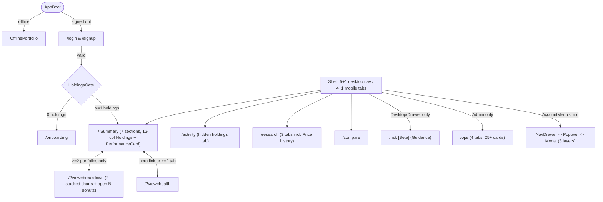
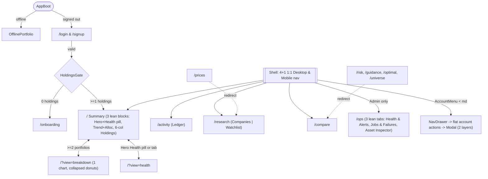
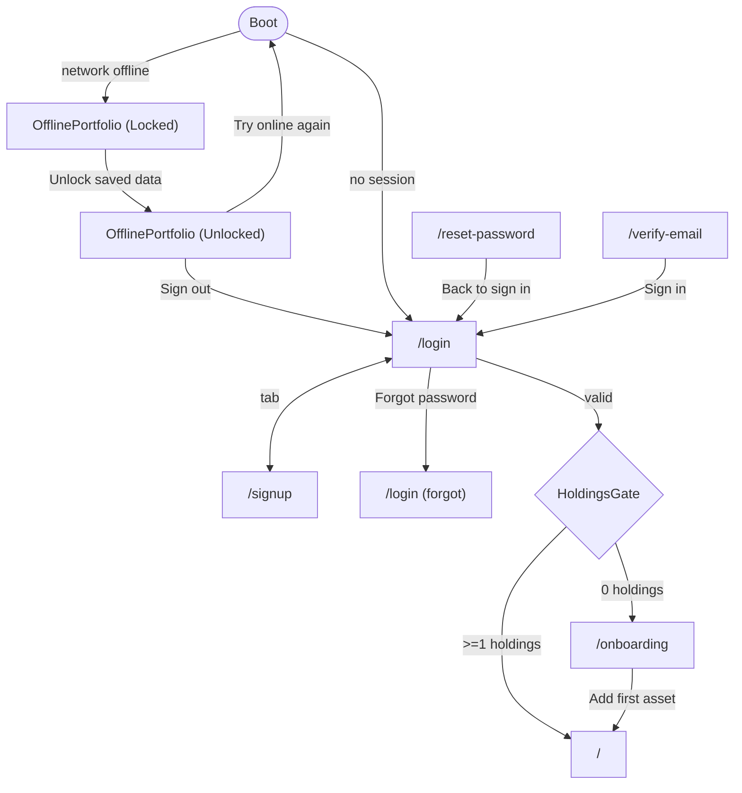
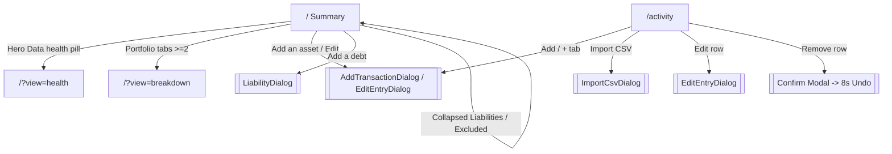
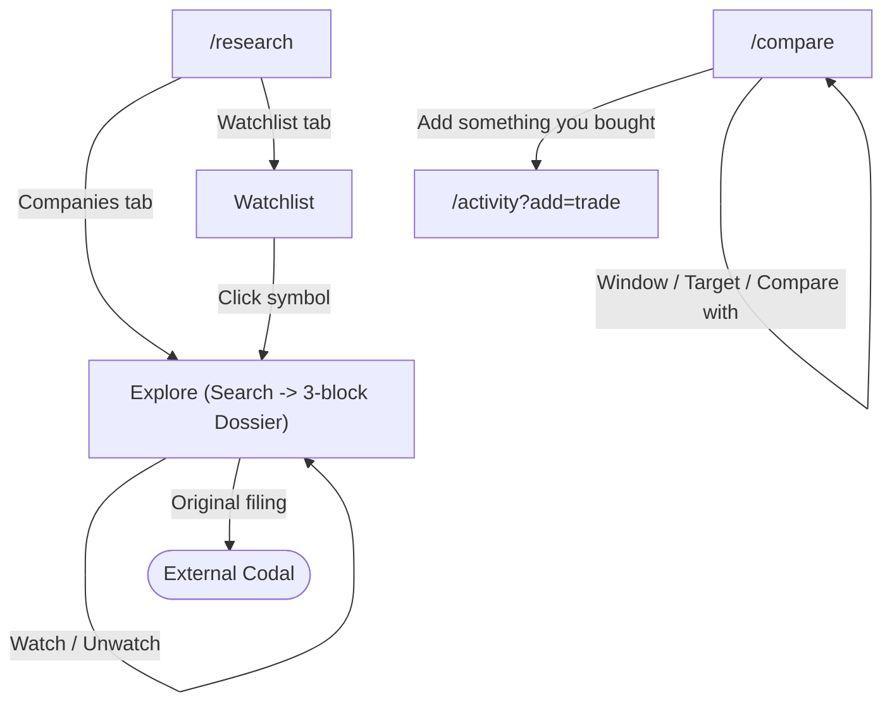
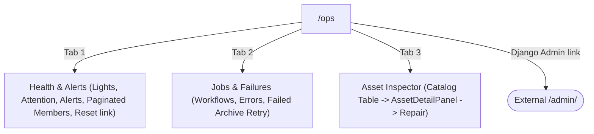

# Portfolio UX Graph (`portfolio-saas/frontend`)

Branch `task/ux-simplification`.
Status: ✅ works, 🟡 partial, 🔴 bug or weak UX, ⚪ not run (source-read / unit-tested only).

## 1. Top-level map (Before vs After)

### Before (redundant routes, 3-layer mobile menu, 7-section Home)

### After (4-item 1:1 nav, 3-block Home, flat mobile menu, 3-tab Ops)

## 2a. Boot, Auth & Native Offline

## 2b. Home, Breakdown & Activity

## 2c. Research & Compare

## 2d. Operations (`/ops`, Admin only)

## 3. Edge-by-edge checkpoint table

| Edge ID | From Node | User Action | Expected Target/State | Live Check | Bug / Note |
|---|---|---|---|---|---|
| A1 | Boot | No session | `/login` | ⚪ | Verified via `App.spec.jsx` / `App.jsx` |
| A2 | `/login` | Switch to `/signup` | `/signup` | ⚪ | |
| A3 | `/reset-password` | Click Back to sign in | `/login` (not `/`) | ⚪ | Fixed in `ResetPassword.jsx` |
| A4 | `/verify-email` | Auto-verify | Single route, links to `/login` | ⚪ | Duplicate route removed in `App.jsx` |
| N1 | Desktop Shell | Click 4 user nav items | `/`, `/activity`, `/research`, `/compare` | ⚪ | Matches Mobile `BottomTabs` 1:1 |
| N2 | Mobile `NavDrawer` | Open Account actions & Change password | Flat drawer items -> single Modal (no Popover) | ⚪ | Fixes 3-layer stack & Escape collision |
| N3 | Legacy `/risk`, `/guidance`, `/optimal`, `/universe` | Navigate | Redirects to `/compare` | ⚪ | `Guidance.jsx` deleted |
| N4 | Legacy `/prices` | Navigate | Redirects to `/research?view=companies` | ⚪ | `AssetHistory.jsx` deleted |
| H1 | `/` | View Home | 3 lean blocks (Hero+Health pill, Trend+Alloc, 6-col Holdings) | ⚪ | `PerformanceCard` removed; Liabilities collapsed |
| H2 | `/` | Click Data health pill | `/?view=health` (works for 1+ portfolios) | ⚪ | Always reachable in `HeroRow` |
| H3 | `/?view=breakdown` | View Breakdown | 1 history chart, collapsed per-portfolio donuts | ⚪ | Redundant 2nd chart removed |
| R1 | `/research` | View tabs | `Companies` and `Watchlist` only (`Price history` removed) | ⚪ | `AssetHistory` removed |
| R2 | `/research?symbol=...` | View Company dossier | 3 crisp blocks (Identity+Chart, Financials, AI+Disclosures) | ⚪ | |
| O1 | `/ops` | Switch 3 tabs | `Health & Alerts`, `Jobs & Failures`, `Asset Inspector` | ⚪ | Split into `pages/ops/` modules; Members paginated |

## 4. Viewport & Language Matrix

| Screen | EN 1440×900 | EN 393×852 | FA 1440×900 | FA 393×852 |
|---|---|---|---|---|
| `/` Home | ⚪ | ⚪ | ⚪ | ⚪ |
| `/activity` | ⚪ | ⚪ | ⚪ | ⚪ |
| `/research` | ⚪ | ⚪ | ⚪ | ⚪ |
| `/compare` | ⚪ | ⚪ | ⚪ | ⚪ |
| `/ops` | ⚪ | ⚪ | ⚪ | ⚪ |

## 5. Root Causes Addressed
1. **7-section Home overload & 12-col table overflow:** Trimmed `Dashboard.jsx` to 3 blocks, removed duplicate `PerformanceCard`, collapsed `LiabilitiesCard`/`ExcludedDisclosure`, trimmed `HoldingsCard` to 6 columns without inline edit/delete modes.
2. **Mismatched Desktop vs Mobile nav & 3-layer mobile menu:** Deleted `/risk` (`Guidance.jsx`) so Desktop & Mobile match 1:1; flattened `AccountMenu` inside `NavDrawer`.
3. **Duplicate Price History & Breakdown charts:** Deleted `AssetHistory.jsx` and the 2nd chart in `Family.jsx`, plus ~650 lines of 6 unused charts in `charts.jsx`.
4. **Monolithic `/ops` (2,611 lines):** Split into 3 lean tabs under `pages/ops/` with paginated `MembersPanel`.

## 6. Local Launch Notes
- Frontend unit/Vitest tests: `cd portfolio-saas/frontend && npm run test:unit && npm run test:vitest`
- Build: `cd portfolio-saas/frontend && npm run build`
- Preview: `cd portfolio-saas/frontend && npm run preview -- --port 4173`
